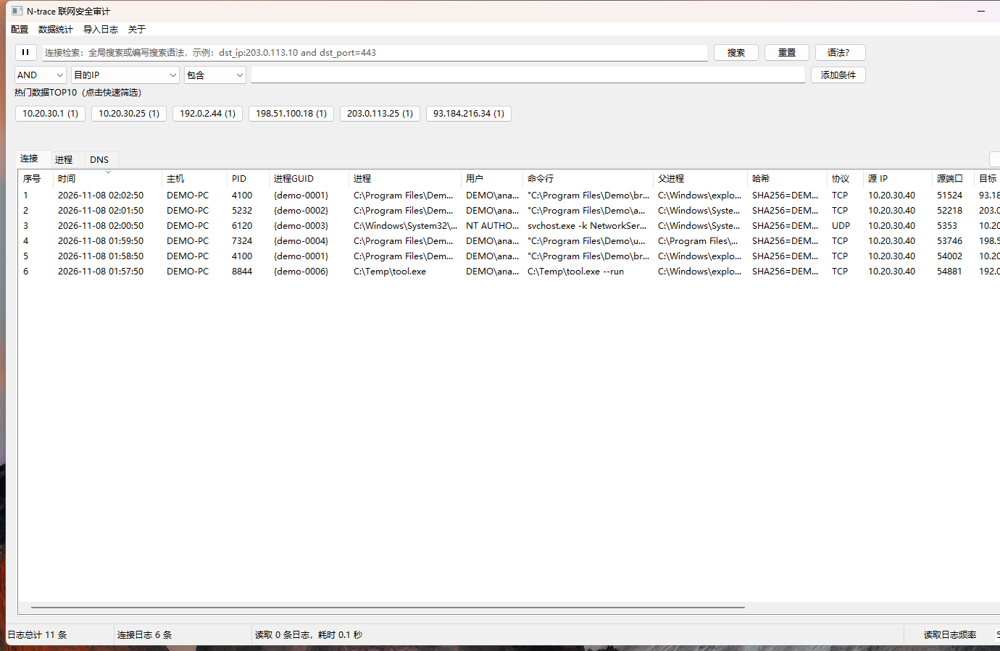
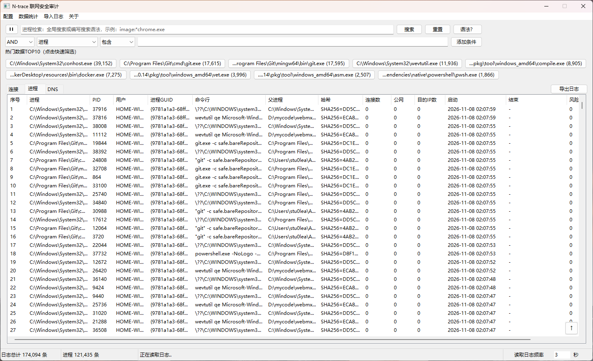
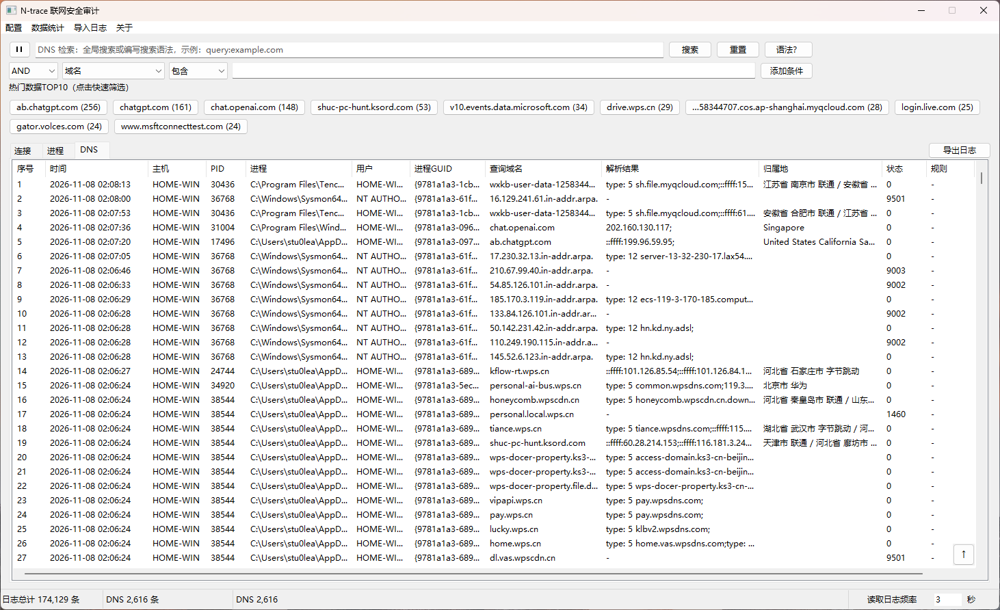
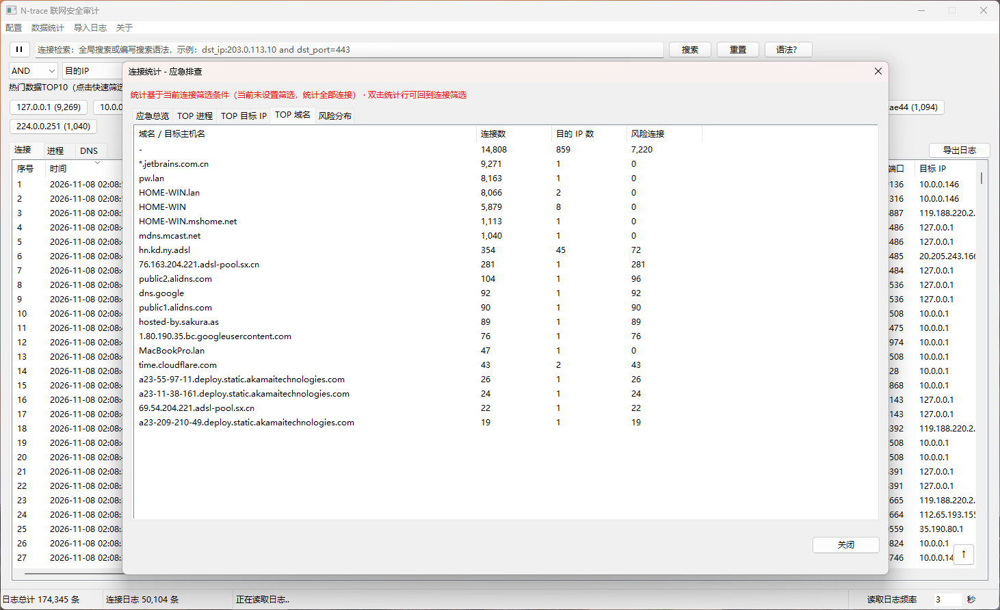
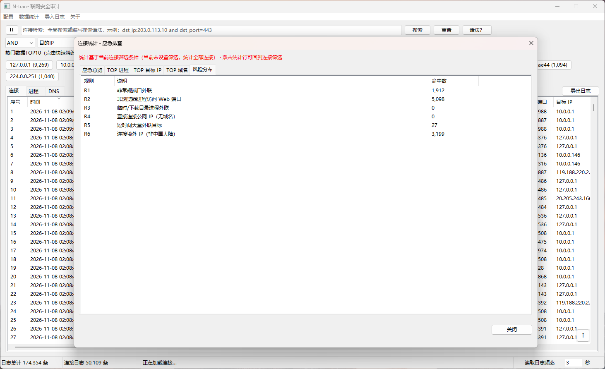
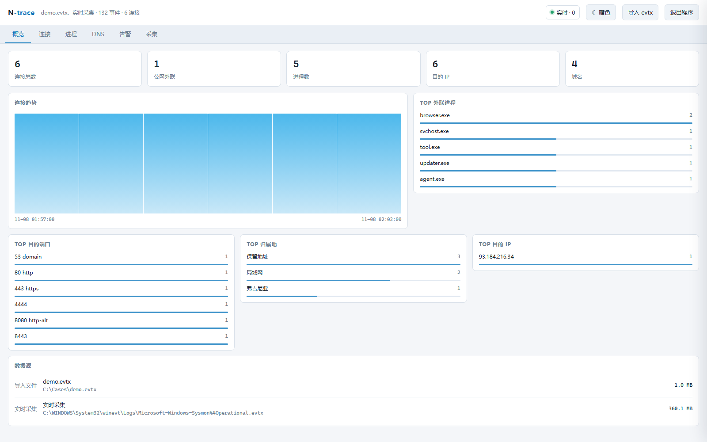

# N-trace 联网安全审计

> 洞察终端恶意非法外联

[GitHub](https://github.com/stu0lea/n-trace) | [MIT License](LICENSE) | [第三方组件说明](THIRD_PARTY_NOTICES.md)

N-trace 是一款面向应急响应和终端排查的 Windows 联网行为审计工具。它基于 Sysmon 日志，在本地完成网络连接、进程和 DNS 查询的采集、检索、统计与导出。程序支持实时读取 Sysmon，也可以直接导入 `.evtx` 做离线分析。

所有分析都在本机完成，不上传日志，不依赖云服务。

## 界面预览

截图仅用于展示当前界面布局。

### Windows 原生 GUI

#### 连接审计



#### 进程审计



#### DNS 审计



#### 数据统计与应急排查



#### 风险分布



### Web UI



## 主要功能

- 单文件运行，Windows 默认使用原生 Win32 界面，无需浏览器和额外运行库。
- 实时读取 `Microsoft-Windows-Sysmon/Operational`，关联 EID 1、3、22，补全进程命令行、父进程、哈希和域名。
- 支持离线导入单个 `.evtx`、目录或多个日志文件。
- 连接、进程、DNS 三张表共用虚拟滚动和分块加载逻辑，可处理 10 万级记录。
- 支持全文搜索、字段筛选、布尔组合、取反、通配和括号分组。
- 内置连接风险规则、DNS 风险分类、全球 IP 归属地和境外 IP 标记。
- 按当前 Tab 查看 TOP 统计，并可从统计项直接跳转到筛选结果。
- 导出当前筛选结果，CSV 使用 UTF-8 BOM，Excel 可直接打开。
- 内置 Sysmon 安装、重装、卸载、日志上限和 DNS 配置管理。
- 实时读取使用持久化 `EventRecordID` 断点，重启后只补读关闭期间新增事件。
- 运行日志按月归档，默认保留 6 个月。

## 平台与 UI 适配

N-trace 采用双 UI 架构：Windows 优先使用原生 Win32 GUI，其他平台使用本地 Web UI。

| 系统 / 模式 | 默认 UI | 实时采集 | 离线 `.evtx` | 启动方式 | 构建工具链 |
|---|---|---|---|---|---|
| Windows amd64 / arm64 | 原生 GUI | 支持 Sysmon | 支持 | 双击 EXE | Windows 固定使用 Go 1.20 |
| Windows `-web` | Web + CMD | 支持 Sysmon | 支持 | 命令行或快捷方式加 `-web` | Windows 固定使用 Go 1.20 |
| macOS Intel / Apple Silicon | Web | 不支持 | 支持 | 终端运行程序 | 本机高版本 Go |
| Linux amd64 | Web | 不支持 | 支持 | 终端运行程序 | 本机高版本 Go |

### Windows 原生 GUI

- 默认双击运行，不创建 CMD 窗口。
- 使用 Win32 原生控件，支持连接、进程、DNS、统计、日志源管理和 Sysmon 管理。
- 支持 Windows 7 及以上的 64 位构建；Windows 10 / 11 为推荐环境。
- 读取 Sysmon、安装 Sysmon 和修改日志上限需要管理员权限。

### Windows Web 模式

```powershell
.\n-trace_windows_amd64.exe -web -addr 127.0.0.1:8899
```

- 启动时创建 CMD 窗口，显示访问地址、数据目录和实时采集状态。
- 使用浏览器操作界面，CMD 窗口按 `Ctrl+C` 可退出。
- 页面右上角提供“退出程序”，会同时停止 Web 服务和实时采集。
- 关闭浏览器标签页不会停止 N-trace。数据目录中的 `open-n-trace.url` 可以重新打开页面。

### macOS / Linux Web 模式

```bash
./n-trace_darwin_arm64
./n-trace_linux_amd64
```

- 默认通过终端启动并进入 Web 模式，不需要额外添加 `-web`。
- 只支持导入 `.evtx` 进行离线分析。
- 不包含 Windows 原生 GUI、Sysmon 安装和 Sysmon 实时采集能力。
- Web 页面只监听本机回环地址，并使用随机访问 token。
- 需要现代 Chrome、Edge、Firefox 或 Safari。

### 构建差异

- Windows 产物使用 Go 1.20，以保持旧版 Windows 兼容性。
- macOS / Linux 产物使用构建机上的高版本 Go。
- `go.mod` 的语言最低版本仍为 Go 1.20，共享代码不能使用更高版本才支持的语言特性。
- Web 模式构建时仍需将 `audit/ui` 嵌入可执行文件。

## 界面与工作流

主界面包含三个数据页签：

| 页签 | 内容 |
|---|---|
| 连接 | EID 3 网络连接、进程、用户、域名、归属地和风险 |
| 进程 | 按进程 GUID 聚合的启动信息、连接数、公网连接数、目标 IP 数和风险数 |
| DNS | EID 22 查询域名、解析结果、归属地、境外解析和查询状态 |

常用入口：

- `配置 -> 日志源管理`：查看实时采集状态、本地日志源，以及安装或卸载 Sysmon。
- `数据统计`：根据当前页签展示连接、进程或 DNS 的独立统计。
- `导入日志`：通过文件选择框、多选或拖拽导入 `.evtx`。
- `关于`：版本、作者和项目地址。
- 语法输入框右侧的 `语法？`：查看当前表支持的完整字段和示例。

表格支持双击查看完整事件，右键单元格添加 `AND` / `OR` 筛选条件。导出按钮只导出当前页签和当前筛选条件命中的全部记录。

## 快速开始

### Windows

1. 运行 `n-trace_windows_amd64.exe` 或 `n-trace_windows_arm64.exe`。
2. 系统会请求管理员权限。读取 Sysmon 日志、安装 Sysmon 和修改日志配置需要管理员身份。
3. 如果系统没有安装 Sysmon，程序会询问是否安装。选择“否”仍可导入 `.evtx` 进行离线分析。
4. 默认数据目录位于程序同目录的 `n-trace-data`，程序会限制为单实例运行。
5. 使用菜单 `导入日志` 选择 `.evtx`，也可以直接把日志拖入主窗口。

也可以从命令行启动并预先导入日志：

```powershell
.\n-trace_windows_amd64.exe
.\n-trace_windows_amd64.exe D:\cases\sysmon.evtx
.\n-trace_windows_amd64.exe D:\cases\
.\n-trace_windows_amd64.exe -data D:\cases\db D:\cases\sysmon.evtx
```

目录参数只会读取目录下的 `.evtx` 文件。

### 浏览器模式

Windows 下使用 `-web` 启动本地浏览器界面和 CMD 窗口。非 Windows 平台会自动使用浏览器模式，但仍只能做离线日志分析。

```powershell
.\n-trace_windows_amd64.exe -web -addr 127.0.0.1:8899 -no-open
```

Web 模式只监听本机回环地址，并使用随机访问 token。关闭浏览器不会停止后台服务，可双击数据目录中的 `open-n-trace.url` 重新打开。

## 命令行参数

| 参数 | 作用 |
|---|---|
| `-data <dir>` | 指定数据目录 |
| `-geo <file>` | 使用外部 `ip2region_v4.xdb`，默认使用内置 IP 库 |
| `-q` | 不打印启动和导入摘要 |
| `-web` | 强制使用浏览器界面 |
| `-addr <host:port>` | Web 模式监听地址，默认随机回环端口 |
| `-no-open` | Web 模式启动后不自动打开浏览器 |
| `-channel <name>` | Web 模式的 Sysmon 日志通道 |
| `-live-interval <duration>` | Web 模式实时轮询间隔，默认 `1s` |

原生界面使用 `config.ini` 中的 `read_interval_seconds` 和 `live_channel`。

## 检索语法

表达式由字段、操作符和值组成。多个条件必须显式写 `and`，不能只靠空格连接。

| 写法 | 含义 |
|---|---|
| `field:value` | 包含匹配 |
| `field!:value` | 不包含，仅用于文本字段 |
| `field=value` | 精确匹配 |
| `field!=value` | 不等于 |
| `field>value`、`field>=value` | 数值或时间比较 |
| `field:*value*` | 通配匹配 |
| `not field:value`、`-field:value` | 取反 |
| `(...)` | 分组，优先级高于 AND / OR |
| `a and b` | 同时满足 |
| `a or b` | 满足任意一个 |
| `field:"value with space"` | 含空格的字段值使用引号 |

常用示例：

```text
dst_ip:203.0.113.10 and dst_port=443
image:*powershell* or cmdline:*encodedcommand*
dst_host:*.example.com and not geo:中国
ts>="2026-11-08 00:00:00" and risk:R6
query:*.github.com
```

连接、进程和 DNS 页签支持的字段不同。点击 `语法？` 可以查看当前页签的完整说明。

## 风险规则

### 连接风险

| 编号 | 含义 |
|---|---|
| `R1` | 非常规端口外联 |
| `R2` | 非浏览器进程访问 Web 端口 |
| `R3` | 临时目录或下载目录进程外联 |
| `R4` | 直接连接公网 IP，且没有关联域名 |
| `R5` | 5 分钟内连接 20 个以上不同公网 IP |
| `R6` | 连接境外 IP，即非中国大陆 IP |

### DNS 风险

| 编号 | 含义 |
|---|---|
| `D1` | 解析到境外 IP |
| `D2` | DNS 查询状态异常 |
| `D3` | 没有解析结果 |

风险规则是排查提示，不代表进程一定恶意。最终结论应结合命令行、父进程、哈希、登录用户和其他终端事件判断。

## 实时读取与断点

实时采集默认读取 `Microsoft-Windows-Sysmon/Operational`，只处理 N-trace 支持的 Sysmon 事件类型。

- `live-last-id.txt` 保存最后成功入库的 `EventRecordID`。
- 正常重启时，从断点之后继续，只补读关闭期间新增的事件。
- 首次启动、断点缺失或 Sysmon 日志轮转时，从当前日志最早记录开始补读。
- 暂停读取不会删除断点；恢复后会补读暂停期间的新事件。
- 每隔固定秒数读取一次，间隔由 `config.ini` 或界面右下角控制。

当前不是 `EvtSubscribe` 实时订阅，而是 `wevtutil` 轮询，因此超高速率场景会有秒级延迟。

## 数据目录

默认目录为程序同目录下的 `n-trace-data`。如果目录不可写，会回退到用户缓存目录。

```text
n-trace-data/
  audit.db
  audit.db-wal
  audit.db-shm
  config.ini
  live-last-id.txt
  sysmon-dns.xml
  trace-audit.log
  trace-audit-YYYY-MM.log
```

| 文件 | 说明 |
|---|---|
| `audit.db` | SQLite 数据库，保存连接、进程事件、进程聚合、DNS、日志源和 FTS 索引 |
| `live-last-id.txt` | 实时读取断点 |
| `config.ini` | 读取间隔、通道、应用日志保留月数和 Sysmon 日志上限 |
| `sysmon-dns.xml` | DNS 查询采集配置 |
| `trace-audit.log` | 当前应用运行日志 |
| `trace-audit-YYYY-MM.log` | 跨月自动归档的历史运行日志 |

`config.ini` 示例：

```ini
read_interval_seconds = 5
live_channel = Microsoft-Windows-Sysmon/Operational
log_retention_months = 6
sysmon_log_max_gb = 2.0
```

`log_retention_months` 只控制运行日志归档，不会自动删除 `audit.db` 中的审计数据。

## 构建

### 环境要求

- Go 1.20 或更高版本。
- Windows 交叉编译使用 Go 1.20，以保持对旧版 Windows 的兼容。
- 项目只构建和发布 64 位产物。

### Windows 本机构建

```powershell
$env:CGO_ENABLED = "0"
go test .\audit
go build -trimpath -ldflags="-s -w -H=windowsgui" -o .\outputs\n-trace_windows_amd64.exe .\audit
```

### 完整构建

```bash
./build.sh
```

`build.sh` 会同步内置 IP 库、Sysmon 安装包和 Windows 资源清单，产物输出到 `outputs/`。

## 项目结构

```text
audit/              Go 主程序、SQLite、查询引擎、原生 UI 和 Web 调试界面
audit/data/         内置 IP 库和 Sysmon 安装包
audit/ui/           浏览器调试界面资源
audit/uiwin/        Windows 原生 UI 资源
docs/               设计和开发文档
outputs/            构建产物和数据目录
```

更偏开发视角的模块说明见 [audit/README.md](audit/README.md)。

## 安全与隐私

- N-trace 不上传审计数据，默认只在本机处理日志。
- 管理员权限用于读取 Sysmon 通道和执行 Sysmon 安装、卸载、日志配置命令。
- 安装或卸载 Sysmon 前应先确认当前终端处于可接受变更的维护环境。
- 不要将包含敏感主机名、用户名、命令行或 IP 地址的数据库和导出文件提交到公开仓库。
- 如果发现安全问题，请避免在公开 Issue 中直接附带真实日志、凭据或终端敏感信息。

## 已知限制

- Sysmon 事件是主要数据源，没有部署 Sysmon 时只能导入已有 `.evtx`。
- 当前只分析 N-trace 支持的连接、进程和 DNS 事件，不解析数据包内容。
- EID 3 不包含流量字节数和连接时长。
- 全文索引使用 FTS5 trigram，过短关键词会退化为普通模糊匹配。
- 进程结束事件依赖 EID 5；如果 Sysmon 配置未采集该事件，进程只能看到启动信息。
- Sysmon 不同版本和 Windows 版本支持的事件字段不同。

## 开源协议

N-trace 自有源代码采用 [MIT License](LICENSE)。

第三方组件、内置 Sysmon 二进制、IP 数据库和 Go 依赖不纳入 MIT 授权，仍遵循各自许可证。详见 [THIRD_PARTY_NOTICES.md](THIRD_PARTY_NOTICES.md)。

已发布的 MIT 版本不会被后续版本收回。未来单独提供的企业模块或商业版本可以采用独立商业许可。
